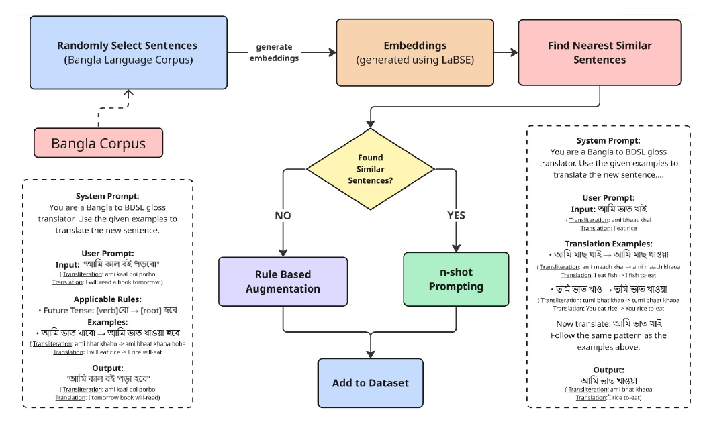

# Bangla-SGP

Bangla-SGP — **[LREC 2026]** — is a parallel dataset of human-annotated and
rule-augmented Bangla sentence–gloss pairs for **Bangla Sign Language (BdSL)
translation research**, built with professional signers.

[Paper (landing page + PDF)](https://lrec.elra.info/lrec2026-main-820) · [DOI](https://doi.org/10.63317/38qenrwzegr9) · [Poster video](https://f003.backblazeb2.com/file/lrec-media/lrec2026/videos/498.mp4) · [Poster](docs/poster.md) · [How to cite](#how-to-cite)



## Overview

Bangla Sign Language (BdSL) translation is a low-resource NLP task: prior
resources stop at word-level and alphabet-level detection, while
sentence-level translation has no large-scale dataset. Bangladesh has around
13 million people with hearing difficulties, 3 million of whom are deaf;
most use BdSL as their primary method of communication.

Bangla-SGP addresses the missing sentence layer. Its **gloss sequences** —
individual Bangla sign-supported words arranged in the order they are
signed — serve as an intermediate representation for continuous signing.
The dataset was annotated by a professional signer and expanded with 3,000
synthetic pairs through three published augmentation methods, and was used
to fine-tune mBART-50, mT5, NLLB-200 and GPT-4.1-nano for Bangla
sentence-to-gloss translation with BLEU and COMET evaluation, benchmarked
alongside RWTH-PHOENIX-2014T.

The paper:

> Saha, N., Shahriyar, R., Roudra, N. A., Sakib, S., & Rasel, A. A. (2026).
> Introducing a Bangla Sentence – Gloss Pair Dataset for Bangla Sign Language
> Translation and Research. In *Proceedings of the Fifteenth Language
> Resources and Evaluation Conference (LREC 2026)* (pp. 10457–10466).
> European Language Resources Association (ELRA).

From the paper's Dataset Availability Statement (§6): *"The Bangla-SGP
dataset will be made publicly available upon publication through our
official repository at GitHub. The dataset will be released under the CC
BY-4.0 license and all augmentation rules, and documentation will be
included in the repository."* — This repository is that release.

## What is in this repository

| Artifact | Where | Notes |
|---|---|---|
| Dataset (canonical, with stable IDs) | [`data/`](data/README.md) | 997 human-annotated + 3,000 synthetic rows |
| Untouched distributed archive | `data/raw/` | byte-identical to the original files |
| Compiled translation rules (prompt form) | [`docs/prompts/translation-rules-prompt.md`](docs/prompts/translation-rules-prompt.md) | verbatim |
| Linguistic rules & conventions | [`docs/linguistic-rules.md`](docs/linguistic-rules.md), [`docs/glossing-conventions.md`](docs/glossing-conventions.md) | text-to-gloss rule families, signed-order phenomena |
| Augmentation methods documentation | [`docs/augmentation-methods.md`](docs/augmentation-methods.md) | three methods, pipeline parameters, validation |
| Annotation & validation protocol | [`docs/annotation-protocol.md`](docs/annotation-protocol.md) | annotators, consent, Cohen's kappa |
| Dataset datasheet | [`DATASHEET.md`](DATASHEET.md) | composition, collection, limits, licensing |
| Dataset statistics | [`docs/dataset-statistics.md`](docs/dataset-statistics.md) | counts computed from the released files |
| Error analysis | [`docs/error-analysis.md`](docs/error-analysis.md) | model failure patterns (paper Table 4) |
| Figures & poster | [`docs/figures/`](docs/figures/), [`docs/poster.md`](docs/poster.md) | paper Figures 1–4, poster renders |
| ID assignment script | [`scripts/assign_ids.py`](scripts/assign_ids.py) | regenerates canonical data from raw deterministically |
| Hugging Face dataset card | [`hf/README.md`](hf/README.md) | ready for the [OpenCR-lab HF org](https://huggingface.co/OpenCR-lab) |

## Data at a glance

| Zone | Train | Validation | Test | Total |
|---|---:|---:|---:|---:|
| `human` (annotated by professional signer) | 797 | 100 | 100 | 997 |
| `augmented` (human train + synthetic) | 3,797 | 100 | 100 | 3,997 |

- Synthetic rows by method (`generation_type`): RAG-based few-shot prompting
  2,119; rule-based morphological transformation 498; masked-token
  substitution 383.
- The validation and test splits are **shared** between both zones so model
  results stay comparable (80/10/10 split, per paper §3.3/§4).
- Synthetic-data validation: 75.3% average validation rate, quality score
  3.19/5, binary agreement κ = 0.7489 (paper Table 1).

### Loading

Hugging Face:

```python
from datasets import load_dataset
human = load_dataset("OpenCR-lab/Bangla-SGP", "human")
aug   = load_dataset("OpenCR-lab/Bangla-SGP", "augmented")
```

Plain Python:

```python
import json
train = json.load(open("data/human/train.json", encoding="utf-8"))
```

Row format and the stable-ID scheme (`bsgp-h-####` / `bsgp-m-####` /
`bsgp-c-####` / `bsgp-r-####`) are documented in [`data/README.md`](data/README.md) and
[the glossing conventions](docs/glossing-conventions.md).

## Results (paper Tables 2 and 3)

Sentence-to-gloss translation, fine-tuned on Bangla-SGP (BLEU / COMET):

| Model | Dataset | BLEU-1 | BLEU-2 | BLEU-3 | BLEU-4 | COMET |
|---|---|---:|---:|---:|---:|---:|
| mT5-small | Base (1K) | 51.79 | 36.26 | 25.73 | 17.56 | 0.8564 |
| mT5-small | Augmented (4K) | 55.33 | 40.11 | 29.06 | 20.28 | 0.8602 |
| mBART-50 | Base (1K) | 56.65 | 40.96 | 29.36 | 21.06 | 0.7829 |
| mBART-50 | Augmented (4K) | 61.09 | 46.01 | 35.09 | 27.31 | 0.8261 |
| GPT-4.1-nano | Augmented (4K) | 57.11 | 41.50 | 31.11 | 22.42 | 0.8913 |
| NLLB-200-1.3B | Base (1K) | 67.99 | 40.82 | 26.49 | 16.67 | 0.907 |

Augmentation helps across models: mBART-50 improves from 21.06 to 27.31
BLEU-4 and 0.7829 to 0.8261 COMET on the augmented set.

Comparison with RWTH-PHOENIX-2014T under identical settings
(paper Table 3 — *for reference; direct cross-linguistic comparison of BLEU
scores is not implied*):

| Dataset | Model | BLEU-1 | BLEU-2 | BLEU-3 | BLEU-4 | COMET |
|---|---|---:|---:|---:|---:|---:|
| RWTH-PHOENIX-2014T | mBART-50 | 48.49 | 35.01 | 26.85 | 21.49 | 0.6673 |
| RWTH-PHOENIX-2014T | mT5-small | 54.79 | 36.47 | 25.42 | 18.73 | 0.6205 |
| Bangla-SGP 4K | mBART-50 | 61.09 | 46.01 | 35.09 | 27.31 | 0.8261 |
| Bangla-SGP 4K | mT5-small | 55.33 | 40.11 | 29.06 | 20.28 | 0.8602 |

Note on GPT-4.1-nano: it is a closed-API model; its fine-tuned weights
cannot be redistributed — released instead are the data, prompts and rules
that reproduce the data-generation side (see DATASHEET §6). Flow diagrams
and worked examples for the augmentation methods are in
[docs/augmentation-methods.md](docs/augmentation-methods.md).

## How the linguistic layer was built

- Rules were compiled with the professional signer and were applied
  mechanically thereafter (paper §3.2.1). The full prompt with all seven
  rule categories is published verbatim in
  [`docs/prompts/translation-rules-prompt.md`](docs/prompts/translation-rules-prompt.md).
- Reference contrasts anyone adopting the dataset should know: written
  Bangla and signed Bangla differ on determiner order, temporal adverbs,
  numerals, and words that decompose into multi-gloss sequences
  (for instance, "সপ্তাহ" (shoptaho) ’week’ → "সাত দিন" (shat din)
  ’seven days’) — see
  [`docs/linguistic-rules.md`](docs/linguistic-rules.md) for the full list
  and [`docs/augmentation-methods.md`](docs/augmentation-methods.md) for how
  these were taught to models.

## Licences

| | File | Licence |
|---|---|---|
| Dataset (`data/`) | [`DATA_LICENSE.md`](DATA_LICENSE.md) | CC BY-4.0 |
| Code, scripts, documentation | [`LICENSE`](LICENSE) | MIT |

The paper text itself is published in the LREC 2026 proceedings; use the
official landing page for the authoritative version.

## Authors and contributions

The Bangla-SGP team:

| Name | Affiliation (paper) |
|---|---|
| Neelavro Saha | Dept. of CSE, BRAC University |
| Rafi Shahriyar | Dept. of CSE, BRAC University |
| Nafis Ashraf Roudra | Dept. of CSE, BRAC University |
| Saadman Sakib | Dept. of CSE, BRAC University |
| Annajiat Alim Rasel | Dept. of CSE, BRAC University |

<!-- TODO(author-github-handles): fill in per-author GitHub profile links,
     per the org structure file convention of linking people, before push. -->

Individual CRediT contribution roles will be recorded in line with the
authors' own contribution statements (CRediT taxonomy; see CITATION.cff for
the citation record).

### Acknowledgements — the signers

The dataset's linguistic reliability rests on the professional signers,
named with their consent:

- **Mr. Ariful Islam** — experienced Bangla sign language presenter at
  BTV: gloss annotation of the full pair set.
- **Mrs. Tanjila Tartushi** — professional sign presenter at BTV:
  independent validation of the synthetic samples.

We thank them for their time and judgement (paper §3.3, §7.3).

## How to cite

If you use the dataset, cite the paper:

```bibtex
@inproceedings{saha-etal-2026-introducing,
  title     = "Introducing A Bangla Sentence -- Gloss Pair Dataset for
               Bangla Sign Language Translation and Research",
  author    = {Saha, Neelavro and Shahriyar, Rafi and Roudra, Nafis Ashraf and
               Sakib, Saadman and Rasel, Annajiat Alim},
  booktitle = {Proceedings of the Fifteenth Language Resources and Evaluation
               Conference (LREC 2026)},
  pages     = {10457--10466},
  year      = {2026},
  publisher = {European Language Resources Association (ELRA)},
  doi       = {10.63317/38qenrwzegr9},
  url       = {https://lrec.elra.info/lrec2026-main-820}
}
```

A machine-readable [`CITATION.cff`](CITATION.cff) is included (GitHub shows
it under "Cite this repository").

## Contact

- Repository maintained by **OpenCR-lab** — an independent research group —
  at <opencr603@gmail.com>.
- Author correspondence: the emails listed in
  [`CITATION.cff`](CITATION.cff).

## Status & roadmap

- **Released (v1.0.0):** dataset with stable IDs, untouched raw archive,
  the full rule-embedded prompt, linguistic documentation, annotation
  protocol, datasheet, statistics, error analysis, figures/poster renders,
  HF dataset card.
- **Not part of this release (flagged):** training/evaluation code for the
  reported models, the masking and generation driver scripts, and
  GPT-4.1-nano weights (closed-API model). If your research needs any of
  these, please contact us — see the paper for full methodology details.
- **Phase 2 (paper §7.2):** synchronized sign video collection and
  non-manual marker annotation with multiple signers; a continuous
  3D signing pipeline built on the gloss layer.
