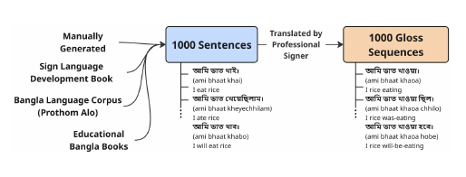

# Annotation and validation protocol

How the human-annotated pairs were created, and how the synthetic pairs were
checked. Sources: paper §3.1–3.3 (Table 1), §7.3, and the released data.

## 1. Pair creation (the 1,000 annotated pairs)

- **Sources of Bangla sentences:** collected from a variety of sources,
  including Bangla newspaper corpora, Bangla literature, the BdSL language
  development book, and educational Bangla books (paper §3.1, Figure 1).
- **Sentence collection was curated** by the research team; grouping into
  `topic`/`subtopic` labels is a curation artifact, kept in the released data
  for retrieval and research filtering.
- **Gloss annotation** was performed by **Mr. Ariful Islam**, an experienced
  Bangla sign language presenter at Bangladesh Television (BTV), who
  translated each sentence to its gloss sequence.
- The paper records the team's stance: annotation by an expert is the
  reliability foundation of the dataset, and it is also expensive — "manual
  annotation of Bangla sentence-gloss pairs by an expert is an expensive
  procedure due to the limited availability of Bangla sign language experts"
  (§7.1). Only one expert annotated the base set, which the paper flags as
  potential signer bias.

## 2. Independent validation of synthetic pairs (Table 1)

To validate the RAG-based augmentation, 15% of the generated pairs (150
samples from the first 1,000 generated) were reviewed by **two professional
BdSL signers** — **Mr. Ariful Islam** and **Mrs. Tanjila Tartushi**, both
professional sign presenters at BTV.

- Reviewers worked **independently, without consulting each other**.
- Each entry was judged on two fields:
  1. **Yes/No** — is the gloss understandable?
  2. **Rating 1–5** — 1 = least understandable / most inaccurate
     translation, 5 = most accurate translation.
- Agreement between the two signers' judgments was measured with
  **Cohen's kappa**.

Results as published in Table 1 of the paper:

| Metric | Signer 1 | Signer 2 | Combined |
|---|---|---|---|
| Validation rate (%) | 74.7 | 76.0 | 75.3 |
| Average quality score | 2.96 | 3.41 | 3.19 |
| High quality (score ≥ 4) | 35.3% | 50.0% | 42.7% |
| Acceptable (score = 3) | 26.0% | 22.7% | 24.3% |
| Low quality (score ≤ 2) | 38.7% | 27.3% | 33.0% |
| Binary agreement (Cohen's κ) | — | — | 0.7489 (substantial) |
| Quality agreement (Cohen's κ) | — | — | 0.3496 (fair) |

The paper's conclusion: binary agreement is substantial, quality agreement is
fair, most glosses met practical quality standards, and the evaluations were
consistent and trustworthy — so the augmented data can be used reliably for
Bangla text-to-gloss translation tasks (§3.3).

## 3. Data splits

- The 1,000 expert-annotated pairs were split **80% / 10% / 10%** into
  train / validation / test.
- **The same validation and test sets are shared** by the human-annotated and
  the augmented datasets, "to ensure a fair comparison" of model results
  (paper §4; also noted in the distributed archive's own README).
- In the released files: train 797 + val 100 + test 100 = 997
  human-annotated rows; the augmented training file adds 3,000 synthetic
  rows to the train split.

## 4. Consent and ethics

From the paper's ethical statement (§7.3):

> All of the gloss sequences of the Bangla sentences was annotated with
> explicit consent from a certified Bangla Sign Language (BdSL) interpreter.
> We have obtained informed consent from them and they are aware of their
> data being used for academic research purposes.

- The two named signers consented to public credit in this repository and
  are acknowledged in the README.
- The dataset contains no recordings of the signers and no personal data
  beyond the professional names above.
- Compensation arrangements for the signers are not published with the
  dataset; they are internal to the team's agreements (flagged here for
  transparency; see DATASHEET.md, section "Annotator compensation").

## 5. If you re-annotate

If your project extends or corrects Bangla-SGP, we recommend keeping the
protocol's shape: independent expert reviewers, a binary usable/not-usable
field, a 1–5 quality field, and inter-annotator agreement reported with
Cohen's kappa. Keep row IDs stable so your corrections can point back to
specific released rows.
