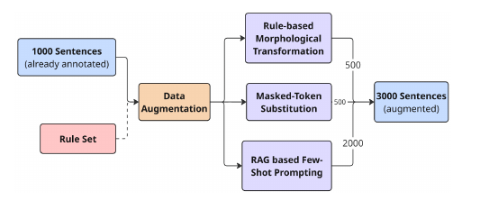
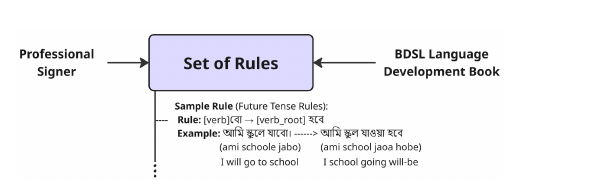
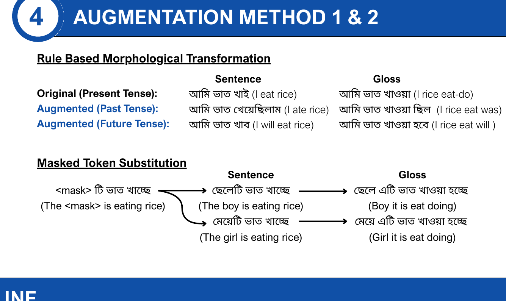
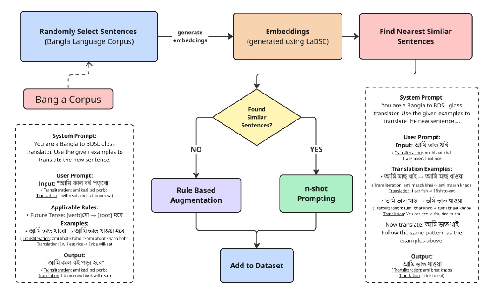

# Data augmentation methods

How the 3,000 synthetically generated pairs were produced. The paper is the
authoritative source (§3.2, Figures 2–4); this page adds the released counts
and manufacturable detail that the official release promised ("all
augmentation rules, and documentation" — Dataset Availability Statement,
§6). The rule set itself lives in
[prompts/translation-rules-prompt.md](prompts/translation-rules-prompt.md);
the linguistic background is in [linguistic-rules.md](linguistic-rules.md).

## The pipeline at a glance

Starting point: 1,000 sentence–gloss pairs annotated by a professional
signer — larger than any prior Bangla text-to-gloss resource, but still too
small for stable fine-tuning (paper §3.2). Three methods were applied:

With these methods, 3,000 new synthetic entries were generated; the final
dataset is ~4,000 rows with a 1:3 ratio of original to augmented data.

## Method 1 — Rule-based Morphological Transformation

499 rows released as `generation_type: morph_aug` (paper: "around 500")

Rules were extracted collaboratively with the professional signer by
analysing the annotated dataset (paper §3.2.1, Figure 3); the most consistent
patterns are tense mappings. Each rule converts a sentence into another
tense: "আমি ভাত খাই" (ami bhaat khai) ’I eat rice’ was transformed into past
("…খেয়েছিলাম" ’I ate rice’) and future ("…খাবো" ’I will eat rice’) forms,
with the gloss transformed under the matching tense rule. Because glosses
follow verified rules rather than arbitrary transformations, the augmented
pairs stay linguistically accurate and semantically faithful to the original
meaning.

## Method 2 — Masked-Token Substitution

383 rows released as `generation_type: context_aug` (paper: "around 500")

A contextual augmentation: templates like "<mask>টি ভাত খাচ্ছে"
(<mask>ti bhaat khache) ’<mask> is eating the rice’ mask common nouns or
verbs; **BanglaBERT** predicts the most contextually appropriate replacements
for the masked tokens. The generated sentence preserves the grammatical rule
and structure of the original. This was motivated by empirical behaviour we
observed: a model trained on the 1K base set kept failing to generalise
consistent rules — e.g., converting "ছেলেটি" (cheleti) ’the boy’ to
"ছেলে এটি" (chele eti) ’boy it is’ — and needed to see the pattern across
more sentence forms (paper §3.2.2).

## Method 3 — RAG-based Few-Shot Prompting

2,119 rows released as `generation_type: rag_aug` (paper: 2,000)

The third and largest method generates new synthetic pairs grounded in the
human-annotated data:

1. The 1,000 annotated pairs were split 80/10/10 into train/test/validation;
   the **training** split was embedded with **LaBSE** and stored in
   **Pinecone** as the ground-truth reference.
2. Candidates were drawn from the publicly available **Bangla Corpus by
   Nuhash Afnan** (newspaper sentences on varied topics; chosen because its
   formal register aligns with the annotated training data).
3. Candidate sentences are embedded and the nearest annotated pairs are
   retrieved. **Similarity threshold 0.5**: matches above it become few-shot
   examples; examples per prompt are capped (the published pipeline caps at
   20 per prompt).
4. **Fallback:** if nothing scores above 0.5, the prompt sends the compiled
   *rules* instead of examples.
5. **Two-stage prompting** (custom design, GPT-4.1-nano): stage 1 identifies
   the sentence's tense; stage 2 sends only that tense's rules plus the
   retrieved examples — an intermediate reasoning step in the spirit of
   chain-of-thought prompting. This keeps prompts focused and yields better
   glosses (paper §3.2.3).

The RAG path matters for coverage, not just volume: some Bangla words have no
direct BdSL sign and get decomposed ("রেসিপি" ’recipe’ → "খাবার রান্নার
নিয়ম" ’food cooking rules’). Retrieval surfaces such patterns from the
annotated data so the generator reproduces them instead of producing literal
word-for-word glosses.

## Validation of the synthetic data

To check that synthetic outputs are trustworthy, a random **15% sample (150
rows)** of the RAG-generated set was reviewed independently by two
professional signers. Summary (full protocol and table in
[annotation-protocol.md](annotation-protocol.md)):

| Metric | Result |
|---|---|
| Validation rate (gloss understandable) | **75.3%** average (74.7% / 76.0% per signer) |
| Average quality score (1–5) | **3.19** (2.96 / 3.41 per signer) |
| High quality (score ≥ 4) | **42.7%** |
| Binary agreement | κ = 0.7489 (substantial) |
| Quality-rating agreement | κ = 0.3496 (fair) |

The paper's reading: most glosses met practical quality standards, evaluations
were consistent, and the augmented data can be used reliably for Bangla
text-to-gloss translation tasks (§3.3).

## Reproducibility notes

- Released counts per method (taken from `generation_type` in the data):
  morph 498, context 383, RAG 2,119 — the "around 500 / around 500 / 2,000"
  figures in the paper refer to these released counts under round-phrase
  wording; the ratio printed in Figure 2 (500/500/2000) is the paper's
  presentation of the same numbers.
- The rule set and prompt templates are published verbatim in
  [prompts/translation-rules-prompt.md](prompts/translation-rules-prompt.md).
- **Not included in this release (flagged):** the BanglaBERT masking/inference
  script, the retrieval/GPT generation driver, and the exact two-stage prompt
  instances beyond the published templates. The archived experiment notebook
  probes an earlier variant; per the maintainers' decision it is not part of
  this release. If you need it for a reproduction, contact us
  (see the README contact section).
