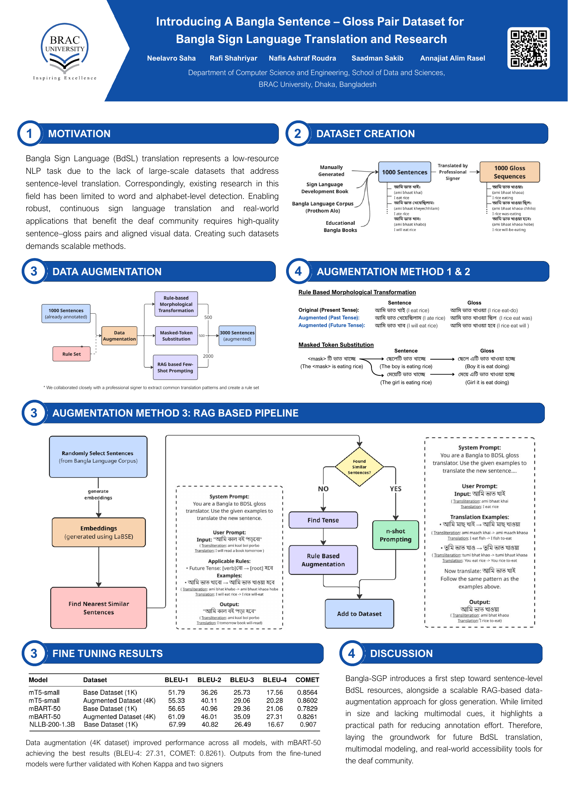
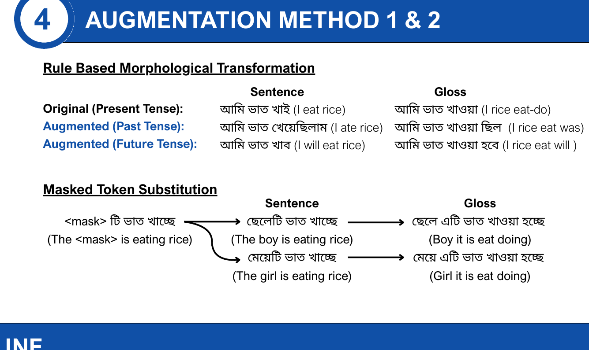
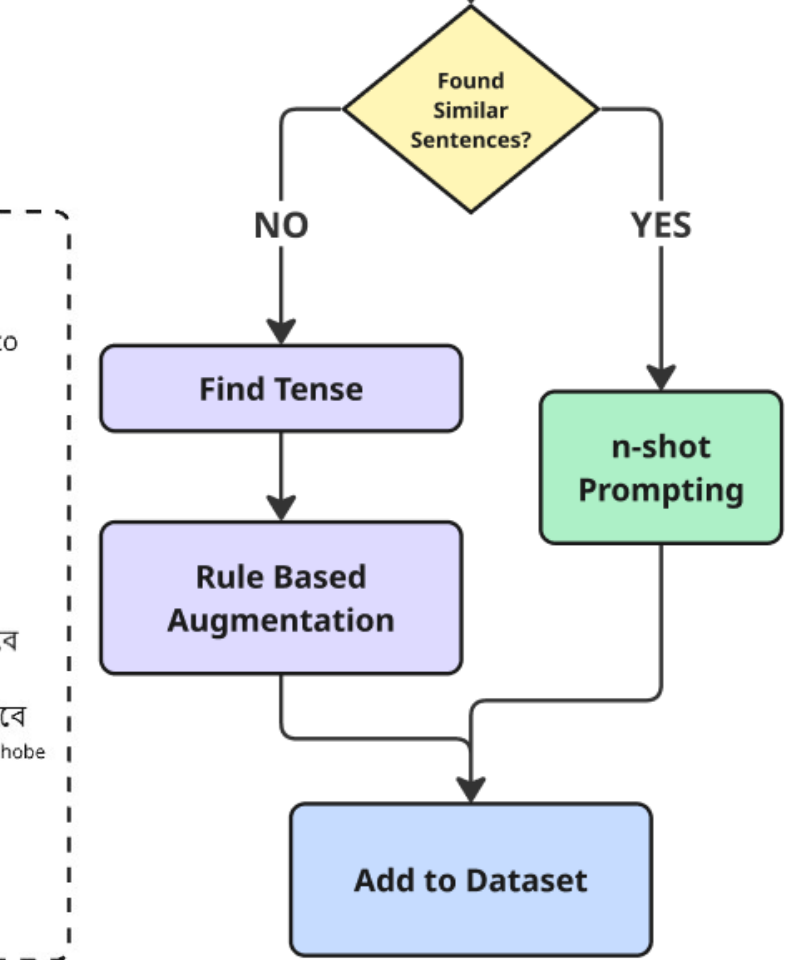

# Poster & presentation

The Bangla-SGP paper was presented with a poster and a recorded video at
LREC 2026. Both are linked from the official paper landing page.

## Poster (A0)

- Rendered full view above; the poster is part of the paper's official
  materials.
- The poster condenses the paper into five panels: motivation, dataset
  creation, the three augmentation methods with worked examples (including
  the exact gloss transformations), the two-stage prompting pipeline, and the
  fine-tuning results.

## Worked examples useful for teaching

The poster's "Augmentation Method 1 & 2" panel shows a complete tense cycle
of "আমি ভাত খাই" (ami bhaat khai) ’I eat rice’ — present, past and future —
with both the transformed sentence and the transformed gloss, and the full
Masked-Token Substitution flow:

> "<mask> টি ভাত খাচ্ছে" (The <mask> is eating rice)
> → "ছেলেটি ভাত খাচ্ছে" (The boy is eating rice) → "ছেলে এটি ভাত খাওয়া হচ্ছে"
> → "মেয়েটি ভাত খাচ্ছে" (The girl is eating rice) → "মেয়ে এটি ভাত খাওয়া হচ্ছে"

The RAG two-stage prompting flow (published pipeline):

## Links

| Resource | Where |
|---|---|
| Paper landing page (PDF, poster, video) | <https://lrec.elra.info/lrec2026-main-820> |
| Poster presentation video | <https://f003.backblazeb2.com/file/lrec-media/lrec2026/videos/498.mp4> |
| Paper pages | 10457–10466, Proceedings of LREC 2026, ELRA |
| Talk / slides | Not available for this release |
