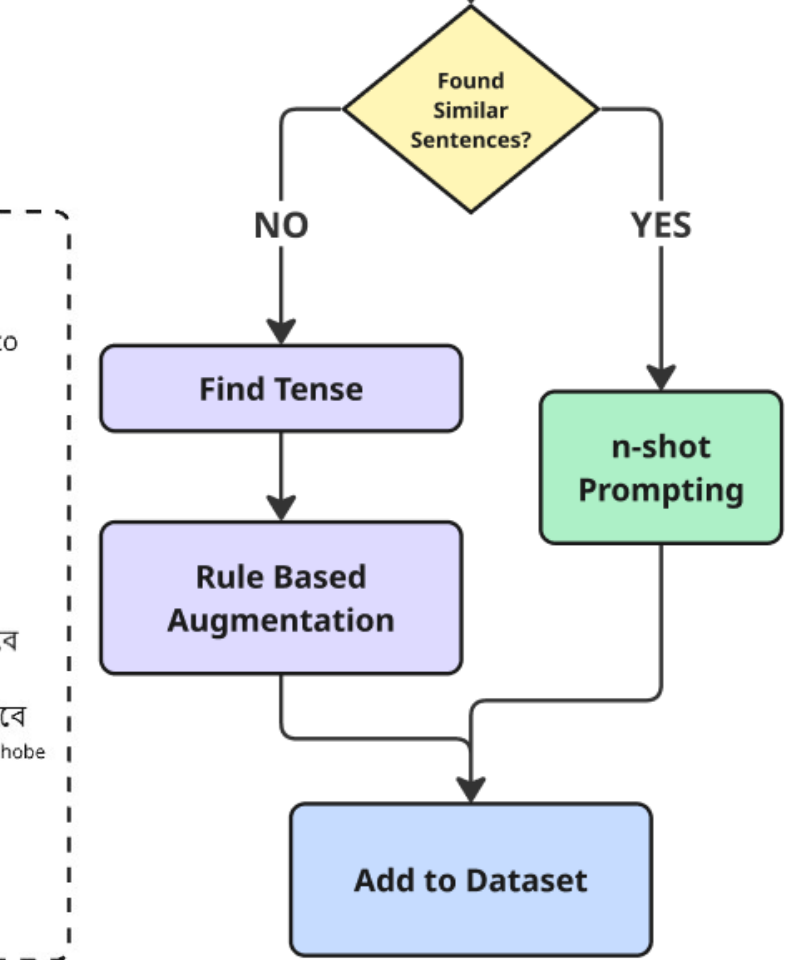

# The rule-embedded translation prompt

This is the prompt system behind Bangla-SGP's gloss generation. It encodes the
translation rules that we compiled together with our professional signer from
the human-annotated data and the BdSL language development book
(paper §3.2.1, Figure 3). It answers the question other researchers most often
ask us: *what exactly converts a written Bangla sentence into a signed-order
gloss?*

Everything in this file is verbatim from our generation material; the Bangla
and the spacing are reproduced as written. Paper §3.2.1, §3.2.2 and §3.2.3,
the LREC poster (see `../poster.md`), and `../linguistic-rules.md` describe the
same rules in prose.

## 1. System message

```
You are an expert translator specializing in converting Bangla text to
Bangladesh Sign Language (BDSL) gloss format.
```

## 2. Base prompt: the translation rules

Sent to the model as the user message, followed by the input sentence
(Section 4). The rule set is organised by tense category, because the paper
found that "each tense follows some consistent morphological rules that maps
the verb of the text form into gloss".

```text
Bangla Text to BDSL Gloss Translation Prompt
You are an expert translator specializing in converting Bangla text to Bangladesh Sign Language (BDSL) gloss format. Your task is to translate the given Bangla sentence into BDSL gloss following the specific grammatical transformation rules provided below.

Translation Rules

Rule Category 1: Simple Present Tense Rules
Rule 1a: [verb phrase] থাকে → [verb-present] থাকা
Example: তার দাদা-দাদি এখন বৃদ্ধাশ্রমে থাকে। → তার দাদি দাদি এখন বৃদ্ধাশ্রম ওখানে থাকা।
Example: তুমি কোথায় থাকো? → তুমি কোথায় থাকা?

Rule 1b: [verb phrase]যায় → [verb-present] হয়
Example: আপনি কীভাবে জানতে পেরেছেন কোন কৌশলে পড়লে ভালো করা যায়? → আপনি কিভাবে জানা কোন কৌশল পড়া ভালো হয়?

Rule 1c: [verb phrase]থাকে / ভালোবাসেন → [verb-present] আছে
Example: আমার মা বই পড়তে ভালোবাসেন। → আমার মা বই পড়া পছন্দ আছে।

Rule Category 2: Simple Past Tense Rules
Rule 2a: [verb phrase]ভরে গিয়েছিল /খেলেছি / কিনতে চেয়েছিল/আজান দিয়েছিলেন/ ক্ষতি করেছিল → [Nominalized verb (ভরা/খেলা/কিনা/চাওয়া)] ছিল
Example: গত শরৎকালে কাশফুলের সৌন্দর্যে মাঠ ভরে গিয়েছিল। → কত শরৎকাল কাশফুল সুন্দর ভরা ছিল।
Example: বাচ্চাটি বাণিজ্য মেলা থেকে খেলনাগুলো কিনতে চেয়েছিল। → বাচ্চা ও বাণিজ্য মেলা থেকে খেলনা কিনা চাওয়া ছিল।

Rule 2b: [TEMP_ADV (গত বছর/ গত সপ্তাহে)] → [explicit numeric form(এক বছর আগে/এক সপ্তাহ আগে)]
Example: গত বছর নিরাপত্তা সেমিনারে অনেক লোক অংশ নিয়েছিল। → এক বছর আগে নিরাপত্তা সেমিনার ওখানে অনেক মানুষ অংশগ্রহণ ছিল।

Rule Category 3: Simple Future Tense Rules
Rule 3a: [verb phrase]বুকিং করবে ./বদলাব → [Nominalized verb (বুকিং/ বদলানো)] হবে
Example: ভ্রমণকারীরা অনলাইনে লঞ্চ টিকিট বুকিং করবে। → ভ্রমণ মানুষ ওরা অনলাইন লঞ্চ টিকেট বুকিং হবে।
Example: আমি কালকে চশমার ফ্রেম বদলাব। → আমি আগামীকাল চশমা ফ্রেম বদলানো হবে।

Rule 3b: [TEMP_ADV (পরের সপ্তাহে)] → [explicit numeric form(সাত দিন পর)]
Example: আমার বন্ধু বলল, তারা পরের সপ্তাহে বেড়াতে যাচ্ছে। → আমার বন্ধু আমাকে বলা তারা সাত দিন পর ঘুরা যাওয়া হবে।

Rule Category 4: Present Perfect Tense Rules
Rule 4a: [verb phrase] ফিরেছেন/পিছিয়েছে /জানিয়েছে → [Nominalized verb (আসা/পিছানো /জানানো)] হয়েছে
Example: তুমি কি শুনেছো, পাশের বাড়ির কাকা হাসপাতাল থেকে ফিরেছেন? → তুমি শোনা আছে, পাশে বাড়ী কাকা উনি হাসপাতাল থেকে আসা হয়েছে?
Example: দুর্নীতির কারণে মামলার রায় পিছিয়েছে। → দুর্নীতি আছে এজন্য মামলা রায় পিছানো হয়েছে।

Rule 4b: [Temporal phrase(শরৎকালীন পিঠার মেলা)] → [Simplified form(শরৎ সময় পিঠা মেলা)]
Example: গ্রামে শরৎকালীন পিঠার মেলা শুরু হয়েছে। → গ্রাম ওখানে শরৎ সময় পিঠা মেলা শুরু হয়েছে।

Rule Category 5: Present Continuous Tense Rules
Rule 5a: [verb phrase]কষ্ট দিচ্ছে / উদ্যোগ নিচ্ছেন /যন্ত্রণায় ভুগছে → [Nominalized verb(কষ্ট দেওয়া)] আছে | [Nominalized verb(চেষ্টা) + Nominalized verb(চেষ্টা)] | [Nominalized verb(কষ্ট) + Nominalized verb(কষ্ট)] আছে
Example: হত্যাকাণ্ডের স্মৃতি পরিবারকে এখনো কষ্ট দিচ্ছে। → আগে হত্যা ছিল ওই বিষয় স্মৃতি পরিবার তাদেরকে এখনো কষ্ট দেওয়া আছে।
Rule 5b: [Noun] রা → [Noun] ওরা

Example: ছাত্র ছাত্রীরা আগামী পরীক্ষার জন্য → ছাত্র-ছাত্রী ওরা আগামী পরীক্ষা হবে
Rule Category 6: Past Continuous Tense Rules
Rule 6a: [verb phrase (আনন্দ করছিল/পার হচ্ছিলো/অসুস্থ বোধ করছিলো)] → [Nominalized verb(আনন্দ/যাওয়া)] ছিল | [Nominalized verb(অসুস্থ) + Nominalized verb(অসুস্থ)] ছিল

Example: বৈশাখের মেলায় শিশু ও তরুণরা নাচ, গান ও খেলাধুলা করে আনন্দ করছিল। → বৈশাখ মেলা ওখানে শিশু ও তরুণ ওরা নাচ, গান, খেলাধুলা আনন্দ ছিল।
Rule 6b: [Object(পুলিশকর্মীকে)]কে → [Subject(পুলিশ)]

Example: সিগনালে দেরি হওয়ায় উত্তেজিত যাত্রী গাড়ির হর্ন বাজিয়ে পুলিশকর্মীকে বিরক্ত করছিলো। → ট্রাফিক সিগনাল দেরি যাত্রী মাথা গরম গাড়ি হর্ন বাজানো পুলিশ বিরক্ত ছিল।
Rule Category 7: Numerical Values Rules
Rule 7a: [Numerical element (তিন/চার/ছয়) in the middle] টা /টি /জন

Example: আমার কাছে তিনটা পেন্সিল আছে। → আমার পেন্সিল আছে তিন।
Example: সে চারটি বই লাইব্রেরি থেকে নিয়েছে। → সে বই লাইব্রেরি থেকে নেওয়া হয়েছে চার।
Example: আমরা ছয়জন বন্ধু একসাথে খেতে গিয়েছিলাম। → আমরা বন্ধু একসাথে খাওয়া যাওয়া ছিল ছয়।

Translation Instructions
1. Analyze the input sentence to identify the tense, grammatical structures, and key elements.
2. Apply the appropriate rules based on the identified tense and grammatical patterns.
3. Transform verb phrases according to the nominalization rules for each tense category.
4. Modify temporal expressions to their explicit numeric forms where applicable.
5. Adjust word order to follow BDSL gloss structure (often moving numbers to the end).
6. Simplify complex phrases while maintaining semantic meaning.
7. Ensure consistency with the provided examples and rule patterns.
```

## 3. Retrieved-examples wrapper (RAG path)

When the retrieval stage finds human-annotated pairs similar to the input
sentence, the model is given them as few-shot material before the input
sentence. Verbatim wrapper from our generation material:

```text
Similar Examples from Database (for reference):
Note: These similar sentences may not have same tense as input sentence, therefore check the given rules to based on the tense of the input sentence.

Example 1: {text} → {gloss} (Similarity: {score})
Example 2: {text} → {gloss} (Similarity: {score})
Example 3: {text} → {gloss} (Similarity: {score})

Input Sentence to Translate:
{bangla_sentence}

Expected Output Format:
Provide only the BDSL gloss translation without explanations or additional text.
```

Retrieval parameters as published in the paper (§3.2.3): sentences embedded
with **LaBSE**, stored in **Pinecone**; similarity threshold **0.5**; the number
of retrieved examples is capped **at 20 per prompt** in the paper's pipeline;
when nothing above threshold is retrieved, the pipeline falls back to sending
the **rules** instead of examples.

## 4. Two-stage prompting (published pipeline)

The paper (§3.2.3) uses a custom **two-stage prompting** strategy for the
released augmentation runs: instead of sending all rules at once — which can
overwhelm the model given the volume of the rule set — the first prompt asks
the model to **identify the tense** of the sentence; only the rules of that
tense, together with the retrieved examples, are then sent in the second
prompt. This mirrors chain-of-thought prompting with an intermediate
reasoning step. The published configuration uses **GPT-4.1-nano** for few-shot
prompting; the figure below is the published pipeline.



> **Provenance note.** The full prompt in Section 2 is the monolithic variant
> from our archived experiment notebook (which ran an earlier batch with a
> different model); the tense-specific decomposition of this same rule set is
> what the published two-stage pipeline sends stage by stage. Both stages are
> built from the same compiled rules — nothing was added or restated.

## 5. Token budget tips

- The rule block is ~7 rules categories; in the two-stage path, send only the
  2–3 rules of the identified tense in stage 2.
- Ask for output only ("Provide only the BDSL gloss translation without
  explanations") to keep samples dataset-clean — every released synthetic row
  is exactly a `sentence` and a `gloss`.
- To extend coverage rather than copy it: label new rules with the tense they
  serve, give at least one worked example pair, and have a professional signer
  verify the resulting glosses before adding rows to any dataset.
